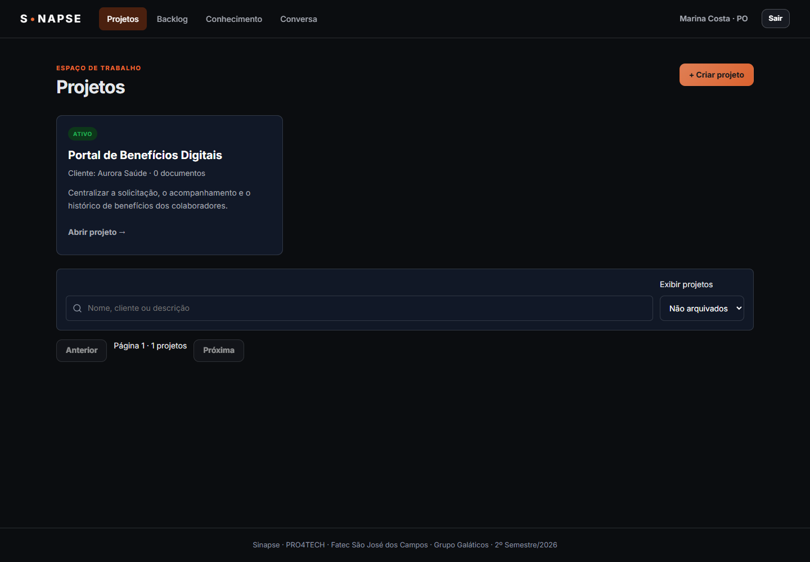
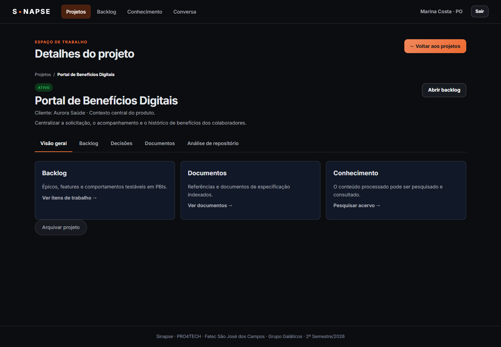
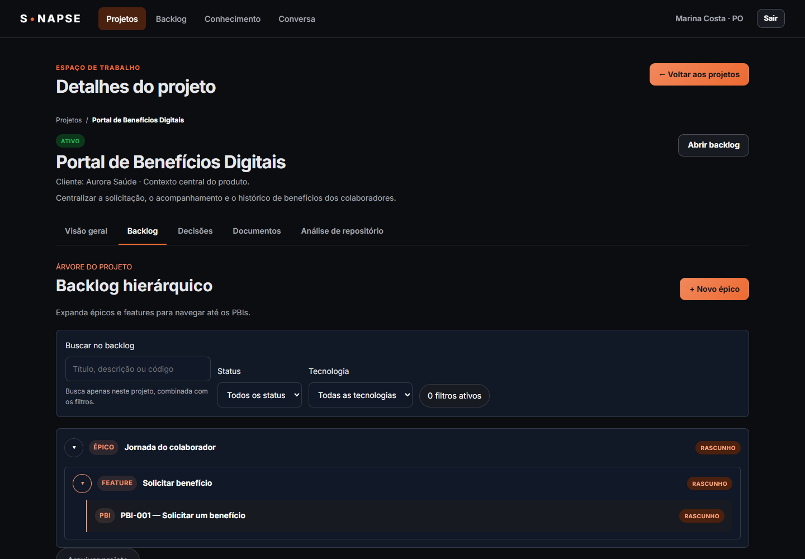
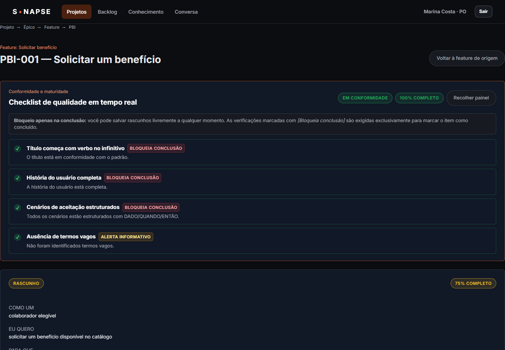
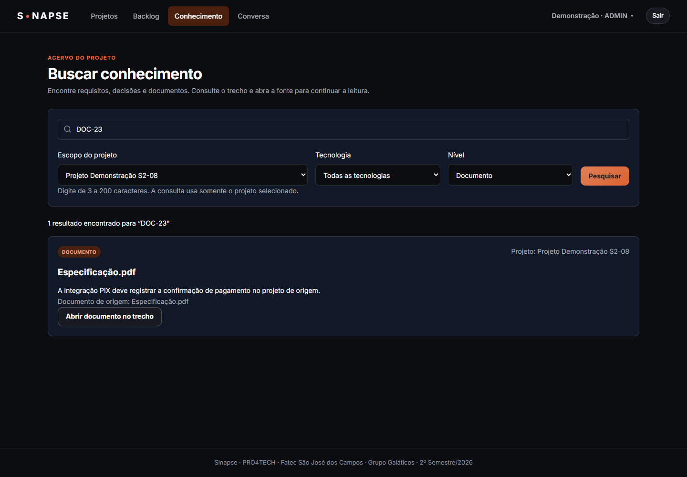
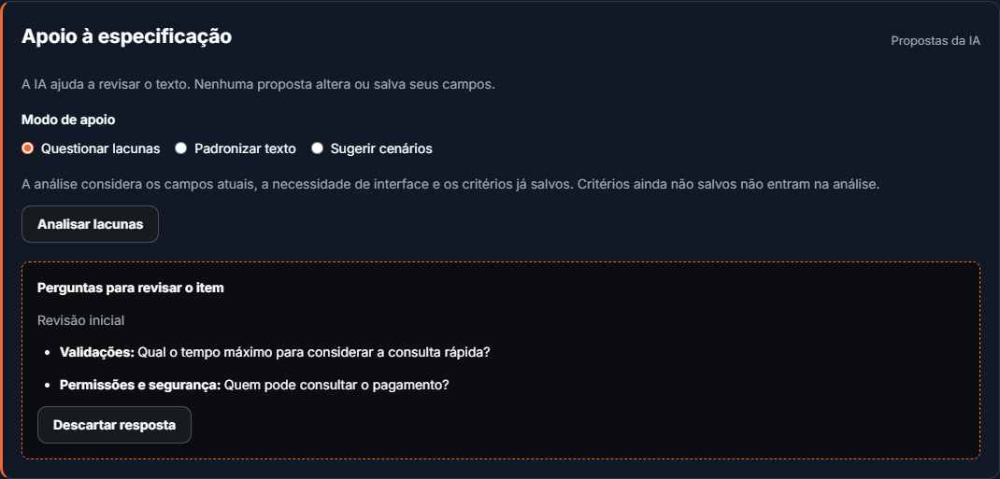
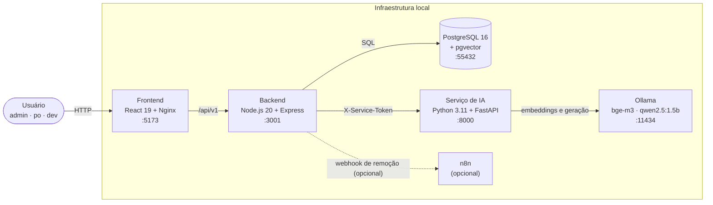
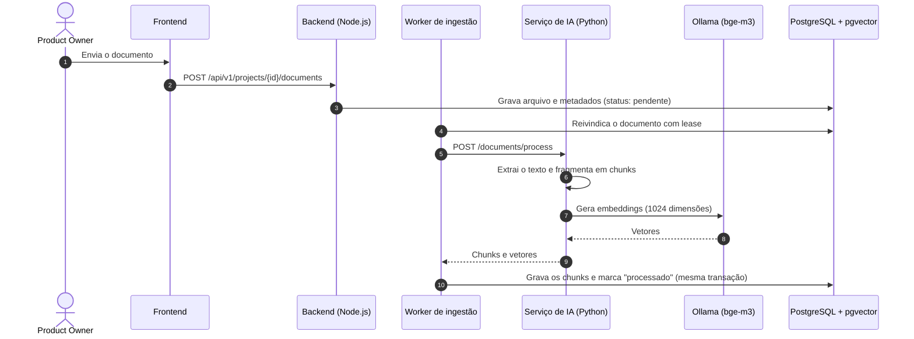
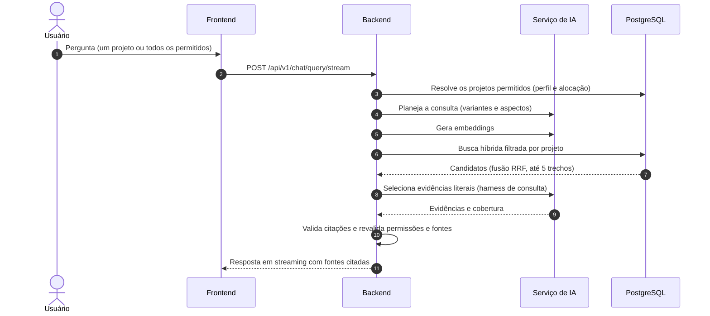
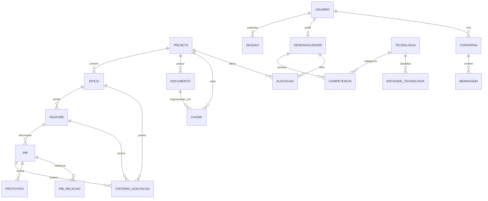

<div align="center">


# Sinapse

**Base inteligente de requisitos e conhecimento para fábricas de software**

*Organize requisitos. Centralize conhecimento. Desenvolva com contexto.*

<br>


**Projeto Integrador (API) · 4º semestre · Análise e Desenvolvimento de Sistemas**
**Fatec São José dos Campos · Grupo Galáticos · Cliente: PRO4TECH**

</div>

---

## 📑 Sumário

1. [🌐 Visão geral](#1-visão-geral)
2. [🧩 Contexto e problema](#2-contexto-e-problema)
3. [💡 Solução proposta](#3-solução-proposta)
4. [⚡ Funcionalidades](#4-funcionalidades)
5. [🏗️ Arquitetura](#5-arquitetura)
6. [🗄️ Modelo de dados](#6-modelo-de-dados)
7. [🛡️ Segurança, privacidade e governança da IA](#7-segurança-privacidade-e-governança-da-ia)
8. [🛠️ Tecnologias](#8-tecnologias)
9. [🚀 Como executar](#9-como-executar)
10. [🧪 Testes e qualidade](#10-testes-e-qualidade)
11. [🔌 API](#11-api)
12. [📁 Estrutura do repositório](#12-estrutura-do-repositório)
13. [🔄 Processo de desenvolvimento](#13-processo-de-desenvolvimento)
14. [🔮 Limitações e trabalhos futuros](#14-limitações-e-trabalhos-futuros)
15. [📚 Documentação](#15-documentação)
16. [👥 Equipe](#16-equipe)
17. [🎓 Contexto acadêmico e licença](#17-contexto-acadêmico-e-licença)

---

## 1. 🌐 Visão geral <a id="1-visão-geral"></a>

O **Sinapse** é uma plataforma web que transforma o trabalho cotidiano de especificação de requisitos em uma **memória técnica reutilizável** da fábrica de software. O Product Owner (PO) estrutura o backlog no padrão da empresa e, como resultado natural desse trabalho, forma um acervo que pode ser consultado por significado, por termos exatos e em linguagem natural, sempre com a indicação das fontes.

A plataforma foi construída pelo **Grupo Galáticos** para a **PRO4TECH — Digital Tech Transformation** e se apoia em quatro ideias centrais:

- **Backlog estruturado e verificável.** O trabalho é organizado na hierarquia `Projeto → Épico → Feature → PBI → Critérios de aceitação`, conforme o *Guia de Especificação de Itens de Trabalho* da PRO4TECH, com validações automáticas e determinísticas da qualidade da especificação.
- **Inteligência Artificial estritamente assistiva.** A IA questiona, sugere e padroniza, mas **nunca grava nada sozinha**: toda sugestão exige uma ação humana explícita (aceitar, editar ou descartar) e a origem de cada campo é registrada.
- **Respostas fundamentadas.** O chat sobre o acervo só afirma o que está nas fontes recuperadas, valida cada citação e se recusa a responder quando não há evidência.
- **Execução local.** Banco de dados, servidores de aplicação e modelos de linguagem rodam em infraestrutura própria, sem enviar dados a serviços de terceiros. A internet é necessária apenas na instalação (imagens Docker, dependências e download dos modelos).

> **Estado do projeto:** as três sprints planejadas foram concluídas, cobrindo os **66 PBIs** do backlog (6 épicos, 18 features e 71 tarefas técnicas). A validação de requisitos não funcionais está registrada em [S3-16](docs/qa/S3-16-validacao-rnfs.md) e a regressão final em [S3-17](docs/qa/S3-17-release-final.md).

<div align="center">


*Fluxo principal: Projeto → Backlog → PBI → Qualidade do requisito.*

</div>

---

## 2. 🧩 Contexto e problema <a id="2-contexto-e-problema"></a>

A PRO4TECH é uma fábrica de software que opera em Scrum, com squads e esteira de DevOps. Durante o levantamento de requisitos, a operação enfrenta (PRD, seção 2):

| Problema | Consequência |
|---|---|
| **Ausência de padrão** | Cada PO documenta funcionalidades de um jeito diferente. |
| **Dispersão da informação** | Conteúdo relevante fica espalhado entre documentos, conversas e projetos. |
| **Baixo reúso** | Soluções já construídas nem sempre são lembradas em novas especificações. |
| **Dependência do conhecimento individual** | O aprendizado de uma pessoa não se transfere e se perde com a rotatividade. |
| **Rastreabilidade custosa** | Recuperar *o que* foi definido, e *por quê*, exige esforço. |
| **Onboarding lento** | Novos integrantes levam tempo excessivo para se contextualizar em sistemas legados. |

> O desafio não é apenas documentar requisitos, mas **transformar o que se aprende em conhecimento reutilizável**.

---

## 3. 💡 Solução proposta <a id="3-solução-proposta"></a>

### 3.1 🏛️ Pilares do produto

| Pilar | O que entrega |
|---|---|
| **Levantamento inteligente** | Estruturação do backlog no padrão da PRO4TECH, com validação de qualidade e um copiloto de IA que aponta lacunas, padroniza o texto e sugere itens semelhantes. |
| **Base de conhecimento** | Todo conteúdo (documentos, itens e decisões) alimenta um acervo pesquisável por significado e por termos exatos. |
| **Chat sobre projetos** | Consulta em linguagem natural ao acervo, com citação obrigatória de fontes. Serve também como ferramenta de onboarding. |
| **Conhecimento sobre a equipe** | Perfis profissionais, competências e alocações, com busca "quem já trabalhou com X?" e recomendação explicável de profissionais. |

### 3.2 🧭 Princípio norteador

> **A Inteligência Artificial não escreve requisitos sozinha. Ela ajuda o Product Owner a pensar melhor sobre eles.**

Esse princípio é garantido pela arquitetura, e não apenas por convenção: o serviço de IA **não tem permissão de escrita** na base de negócio. Ele devolve sugestões, e somente o backend persiste dados após a confirmação do usuário.

### 3.3 🚧 Fronteira de escopo

A gestão da **execução** dos projetos permanece no Azure DevOps. O Sinapse gerencia o **conhecimento** sobre o projeto.

| O Sinapse **não** é | O Sinapse **é** |
|---|---|
| Gestão da execução (sprints, kanban, horas, tarefas, burndown) | Gestão do conhecimento: backlog especificado, decisões, competências e histórico |
| Onde a equipe acompanha o trabalho | Onde a equipe consulta o que já foi aprendido |

### 3.4 🎯 Objetivos e metas

Metas definidas no [PRD](docs/PRD-PRO4TECH.md) (seção 4). São critérios de sucesso do produto, não resultados medidos.

| # | Objetivo | Meta |
|---|---|---|
| O1 | Padronizar a documentação | ≥ 90% dos itens aprovados no checklist de qualidade |
| O2 | Reduzir o esforço de especificação | Redução demonstrável do tempo para especificar uma Feature |
| O3 | Promover o reúso de conhecimento | ≥ 30% dos PBIs criados a partir de sugestão do acervo |
| O4 | Tornar o acervo consultável | ≥ 80% de acerto em 20 perguntas com fonte citada corretamente |
| O5 | Mapear o conhecimento da equipe | ≥ 80% das consultas "quem já trabalhou com X?" corretas |
| O6 | Acelerar o onboarding | Novo integrante responde sobre projeto desconhecido usando apenas o chat |

---

## 4. ⚡ Funcionalidades <a id="4-funcionalidades"></a>

O backlog entregue tem **6 épicos, 18 features e 66 PBIs** (priorização MoSCoW: 45 *Must*, 18 *Should*, 3 *Could*). A tabela resume o que cada épico entrega; os critérios de aceitação completos estão em [`docs/backlog`](docs/backlog/README.md).

| Épico | Tema | PBIs | Sprints |
|---|---|:---:|:---:|
| [EP-01](docs/backlog/EP-01-especificar-backlog.md) | Especificar o backlog de produto no padrão da fábrica | 26 | 1, 2, 3 |
| [EP-02](docs/backlog/EP-02-preservar-conhecimento.md) | Preservar o conhecimento dos projetos | 11 | 1, 2 |
| [EP-03](docs/backlog/EP-03-apoio-inteligencia-artificial.md) | Especificar com apoio da inteligência artificial | 10 | 2 |
| [EP-04](docs/backlog/EP-04-consultar-conhecimento.md) | Consultar o conhecimento em linguagem natural | 7 | 3 |
| [EP-05](docs/backlog/EP-05-competencias-equipe.md) | Mapear as competências da equipe | 7 | 3 |
| [EP-06](docs/backlog/EP-06-acesso-controlado.md) | Operar a plataforma com acesso controlado | 5 | 1, 3 |

### 4.1 📋 Backlog estruturado e qualidade da especificação (EP-01)

A hierarquia segue o guia da PRO4TECH. Cada nível responde a uma pergunta diferente e tem critérios de aceitação próprios:

```text
Projeto
 └── Épico            Que resultado amplo queremos alcançar?      → critérios em nível macro
      └── Feature     Que capacidade o produto precisa oferecer?  → regras gerais da capacidade
           └── PBI    Que comportamento será implementado?        → história COMO UM / EU QUERO / PARA QUE
                └── Critérios de aceitação                        → cenários DADO / QUANDO / ENTÃO
```

- **Conformidade determinística.** O motor de qualidade, executado no backend sem depender de IA, verifica: título do PBI iniciado por verbo no infinitivo; história com os três blocos; critérios escritos em cenários; ausência de termos vagos (dicionário configurável); e vínculo de protótipo, avaliado apenas quando o PBI exige interface.
- **Indicador de completude.** Razão entre as verificações aprovadas e as aplicáveis, de 0 a 100, **sem pesos** e com fórmula explícita. A regra de protótipo sai do denominador quando não se aplica.
- **Padrão configurável.** Dicionário de termos vagos e as definições de preparado/pronto (DoR/DoD) são configuráveis por administradores, com histórico versionado e autoria.
- **Decisões e justificativas** registradas em qualquer nível, com histórico recuperável.
- **Versões e comparação** lado a lado de alterações em itens, com justificativa obrigatória ao editar.
- **Relações entre PBIs** (dependência, similaridade, substituição), com bloqueio de ciclos inválidos.
- **Navegação, filtros e busca textual** no backlog, arquivamento com prévia de impacto e **exportação em Markdown** de épicos e features.

### 4.2 📚 Base de conhecimento (EP-02)

- **Upload de documentos** (TXT, MD, DOCX e PDF com camada de texto; limite padrão de 20 MB por arquivo) vinculados a um projeto.
- **Processamento assíncrono** com estados `pendente → processando → processado | falha`, tentativas automáticas com atraso crescente, reprocessamento manual e tela de observabilidade da fila (`/admin/ingestion`).
- **Indexação automática** de itens concluídos e decisões, com remoção do índice no arquivamento e eliminação consistente do conteúdo de um projeto.
- **Busca híbrida** em português, combinando similaridade semântica e texto exato, com filtros de projeto, nível e tecnologia, e acesso ao trecho de origem.
- **Protótipos** anexáveis a PBIs, sem substituir os critérios escritos.

### 4.3 🤖 Copiloto de IA (EP-03)

Disponível nos formulários de épico, feature e PBI, sempre sob demanda e nunca bloqueando a edição manual:

| Operação | Resultado |
|---|---|
| **Questionar lacunas** | Perguntas agrupadas nas seis dimensões do guia: caminho principal, validações, erros e indisponibilidade, permissões e segurança, estados alternativos, interface e compatibilidade. |
| **Padronizar texto** | Proposta de reescrita nos campos do nível, apresentada como sugestão editável. |
| **Sugerir cenários** | Cenários `DADO / QUANDO / ENTÃO` a partir de uma história completa. |
| **Itens semelhantes** | Candidatos do acervo, sempre com indicação da origem. |

Toda sugestão é **aceita, editada ou descartada** pelo PO, e a **proveniência por campo** é registrada (`human-authored`, `ai-accepted`, `ai-edited`). O comportamento da IA é governado por um **harness versionado** com configurações independentes para os modos *levantamento*, *consulta* e *recomendação*: instruções, limites de espera e listas de termos são editáveis por administradores, com histórico de revisões, e as saídas são validadas contra *schemas* JSON. Todo o fluxo permanece utilizável sem IA.

### 4.4 💬 Conversa com o acervo (EP-04)

- **Respostas fundamentadas** em evidências recuperadas, com **citações validadas** e modal "Fontes e evidências" com navegação até a origem.
- **Recusa honesta.** Sem evidência suficiente, o sistema declara que não encontrou a informação e não anexa fontes. A cobertura é classificada como `complete`, `partial`, `no_evidence` ou `out_of_scope`.
- **Escopo selecionável:** todos os projetos permitidos ao usuário ou um projeto específico, sempre respeitando as permissões.
- **Histórico privado** por usuário, com retomada de conversas preservando mensagens, fontes e escopo.
- **Streaming cancelável** da resposta (SSE).
- **Consultas sobre a equipe** (por exemplo, "Quem trabalhou com TypeScript?") respondidas de forma determinística, com evidências e projetos.

### 4.5 👥 Conhecimento sobre a equipe (EP-05)

- **Perfis profissionais** restritos a dados profissionais (LGPD).
- **Competências** vinculadas a um vocabulário controlado de tecnologias, com nível e evidência.
- **Alocações** por projeto, período e papel, com **histórico de atuação** consolidado automaticamente.
- **Busca "quem já trabalhou com…"** e **recomendação explicável** de profissionais para uma feature. O critério é a aderência às tecnologias da feature, com desempate pela profundidade da experiência. A recomendação é **estritamente consultiva** e nenhuma alocação é feita automaticamente.

### 4.6 🔐 Acesso controlado e administração (EP-06)

- Autenticação por sessão, bloqueio de tentativas indevidas e perfis `admin`, `po` e `dev`.
- **Administração de perfis de acesso**, com autoria e data da última alteração e trava que impede remover ou rebaixar o último administrador ativo.
- **Vocabulário de tecnologias** com prevenção de variações de escrita (por exemplo, `NodeJS` quando já existe a forma canônica) e aviso de impacto antes de remover uma tecnologia em uso.

### 4.7 🔍 Análise de repositório (RepoAnalyzer)

A partir da URL de um repositório do GitHub, o serviço de IA clona e inventaria o repositório e gera um relatório com modelo local. O escopo é escolhido na tela: **Rápida** (até 8 arquivos, padrão), **Equilibrada** (até 80) ou **Completa**. A execução pode ser **pausada, retomada e cancelada**, com checkpoints que sobrevivem à recriação do container. Relatórios de análise só entram no acervo consultável após **aprovação** de uma pessoa.

### 4.8 📸 Telas da aplicação

<div align="center">




<br><br>




<br><br>




</div>

<sub>Capturas com dados sintéticos de demonstração.</sub>

---

## 5. 🏗️ Arquitetura <a id="5-arquitetura"></a>

### 5.1 ⚙️ Visão de execução



| Componente | Implementação | Responsabilidade |
|---|---|---|
| **Frontend** | `frontend/` — React 19, TypeScript, Vite; Nginx na imagem final | Interface (SPA), navegação por projeto, autenticação de interface. Organizado em `models`, `viewmodels` e `views`. |
| **Backend** | `backend/` — Node.js 20, Express, TypeScript | API REST, sessões, autorização, regras de domínio, motor de qualidade, workers em segundo plano e **única escrita nas tabelas de negócio**. |
| **Banco de dados** | PostgreSQL 16 + extensão pgvector | Persistência relacional, busca textual e vetorial (índice HNSW, cosseno, 1024 dimensões). |
| **Serviço de IA** | `ai-service/` — Python 3.11, FastAPI | Extração de texto, fragmentação, embeddings, planejamento de consulta, harness de IA e RepoAnalyzer. **Não escreve no PostgreSQL.** |
| **Ollama** | Runtime local de modelos | `bge-m3` (embeddings) e `qwen2.5:1.5b` (geração). |
| **n8n** | `n8n/` — workflows versionados | **Opcional.** Consumidor de eventos e ferramenta de depuração do pipeline (ver [5.3](#53-ingestão-de-documentos)). |

O backend executa quatro *workers* em segundo plano: ingestão de documentos, indexação de itens, análise de repositório e indexação de relatórios.

### 5.2 💡 Decisões de projeto

| Decisão | Justificativa |
|---|---|
| **Node.js é o único escritor** das tabelas de negócio; o serviço Python só devolve dados e sugestões. | Garante, na arquitetura, que a IA seja assistiva (RNF-01). |
| **Um único banco** (PostgreSQL + pgvector) para dados relacionais e vetoriais. | Atende a execução local e com ferramentas abertas (RNF-03/04) e simplifica o isolamento por projeto. Bancos vetoriais em nuvem foram descartados. |
| **Embeddings `bge-m3`** (1024 dimensões, contexto de 8.192 tokens). | Escolhido no spike PRE-07 ([`scripts/spike_embeddings.py`](scripts/spike_embeddings.py)) por desempenho em português. |
| **Busca híbrida**: similaridade por cosseno (HNSW) + busca textual em português (`websearch_to_tsquery`, `ts_rank_cd`). | Termos como PIX, OAuth ou siglas exigem correspondência exata, em que a busca puramente semântica é imprecisa. |
| **Isolamento por projeto via filtro de metadados**, e não por proximidade vetorial. | Itens semelhantes de projetos distintos são vetorialmente próximos; o isolamento precisa de filtro estruturado. |
| **Worker do backend como canal oficial de ingestão**, com n8n opcional. | O backend chama o serviço de IA diretamente, sem depender de um orquestrador externo no ar; a fragmentação fica em uma única fonte de verdade. |
| **Modelo de linguagem pequeno** (`qwen2.5:1.5b`) com saídas validadas. | Roda em máquinas modestas. A qualidade é compensada por validação determinística: citações literais, *schemas* JSON e recusa sem evidência. |
| **Funcionamento sem IA.** | Backlog, motor de qualidade, busca textual e consultas sobre a equipe continuam operando se o serviço de IA estiver indisponível. |

### 5.3 📄 Ingestão e vetorização de documentos



A fragmentação usa janelas de aproximadamente 1.000 caracteres com sobreposição de 150, priorizando quebras em parágrafos; itens do backlog (épico, feature, PBI) são indexados como unidades únicas, preservando a granularidade definida pelo guia. O *lease* identifica a tentativa, resultados de tentativas antigas são descartados e o reprocessamento substitui os chunks sem duplicar vetores. PDFs digitalizados, sem camada de texto, falham de forma explícita (não há OCR).

> **Sobre o n8n.** O Compose padrão **não inclui um contêiner n8n**. Os workflows de [`n8n/workflows`](n8n/workflows) continuam versionados (com [`n8n-local-sync`](https://pypi.org/project/n8n-local-sync/), validados no CI) e servem como ferramenta de depuração manual do pipeline e como consumidor opcional de eventos de remoção, configurado por `DOCUMENT_EVENTS_WEBHOOK_URL`. Detalhes em [`n8n/README.md`](n8n/README.md) e em [`IMPLEMENTACAO_PIPELINE_INGESTAO.md`](IMPLEMENTACAO_PIPELINE_INGESTAO.md).

### 5.4 🔎 Busca e chat com evidências verificadas



Pontos relevantes do fluxo (detalhados em [`docs/S2-24-rag-evidencias.md`](docs/S2-24-rag-evidencias.md)):

1. As permissões são resolvidas **antes** de qualquer cálculo de embeddings. Uma seleção de projeto não autorizada recebe `404`.
2. Os resultados das consultas planejadas são combinados por *Reciprocal Rank Fusion*, com limite de cinco trechos.
3. O modelo seleciona **passagens literais** do contexto; o backend rejeita IDs fora do contexto enviado, citações não literais e fragmentos que invertam o sentido de uma frase.
4. Após a geração, origens e permissões são **revalidadas**. Se um acesso foi revogado ou a fonte mudou durante a resposta, nada é divulgado.
5. Sem evidência ou fora do escopo, o backend responde com recusa explícita, sem fontes inventadas.

### 5.5 🤖 Copiloto e harness versionado

O backend recebe `POST /api/v1/projects/{projectId}/ai/requests` (exige perfil `admin` ou `po`), recupera por conta própria os trechos do projeto autorizado e chama o serviço Python com a **revisão vigente** do harness. A resposta é validada duas vezes (no serviço de IA e no backend), inclusive contra as regras do guia. A execução **não grava** itens nem sugestões; erros, tempo esgotado ou resposta incompatível retornam `503` com mensagem segura. Veja [`docs/S2-09-HARNESS.md`](docs/S2-09-HARNESS.md) e [`docs/S2-10-COPILOTO.md`](docs/S2-10-COPILOTO.md).

---

## 6. 🗄️ Modelo de dados <a id="6-modelo-de-dados"></a>

O esquema é versionado em [`database/init.sql`](database/init.sql) (*baseline*) e em **41 arquivos de migration** SQL, com prefixos numéricos de `001` a `031` (há prefixos repetidos por causa de migrations históricas), em [`database/migrations`](database/migrations). O backend aplica as pendentes ao iniciar e registra os nomes completos em `_schema_migrations`. As mais de 30 tabelas cobrem identidade e sessões, hierarquia do backlog, critérios, decisões, versões, documentos e chunks, conversas, qualidade organizacional, harness de IA, perfis profissionais, competências e alocações.



A tabela `chunk` guarda o texto, os metadados (JSONB) e o `embedding vector(1024)` com índice HNSW (`vector_cosine_ops`), e carrega `projeto_id` desnormalizado para o isolamento. Diagramas completos: [ERD](docs/Architecture/Diagrams/ERD.mmd), [arquitetura](docs/Architecture/Diagrams/Architecture.mmd) e [fluxo RAG](docs/Architecture/Diagrams/RAG.mmd).

---

## 7. 🛡️ Segurança, privacidade e governança da IA <a id="7-segurança-privacidade-e-governança-da-ia"></a>

### 7.1 🔑 Autenticação e sessões

- Autenticação por **sessão no servidor**: o token é aleatório (32 bytes), enviado em cookie `sinapse_session` e armazenado apenas como **hash SHA-256**. Senhas usam `scrypt`.
- A sessão expira por **inatividade (30 min)** e por **duração máxima (12 h)**. Há **bloqueio por 15 minutos após 5 tentativas** malsucedidas. Todos os valores são configuráveis (`AUTH_*`).
- O cadastro público cria usuários com perfil `dev`; criar ou promover um usuário a outro perfil exige uma sessão de administrador.

### 7.2 👤 Perfis e permissões (RBAC)

| Capacidade | `admin` | `po` | `dev` |
|---|:---:|:---:|:---:|
| Ver backlog, documentos, busca e chat | todos os projetos | todos os projetos | somente projetos com **alocação ativa** |
| Criar e editar projetos, épicos, features, PBIs, critérios e decisões | ✔ | ✔ | — |
| Enviar e remover documentos | ✔ | ✔ | — |
| Acionar o copiloto e resolver sugestões | ✔ | ✔ | — |
| Gerir perfis profissionais, competências e alocações | ✔ | ✔ | — |
| Criar tecnologias no vocabulário | ✔ | ✔ | — |
| Editar ou remover tecnologias; configurar qualidade, harness e perfis de acesso; observar a ingestão | ✔ | — | — |

As regras são aplicadas **na API**; ocultar um botão no frontend não substitui a validação do servidor. A operação de escrita em projeto arquivado também é bloqueada no servidor.

### 7.3 🔒 Isolamento por projeto e privacidade

- **Isolamento por projeto** em busca e RAG, com filtro estrito por `projeto_id`. Consultas de `dev` a projetos sem alocação retornam `404` antes de acionar o serviço de IA.
- **Revogação concorrente:** se uma alocação termina ou uma fonte perde elegibilidade durante a geração, a resposta é abortada sem divulgar trechos.
- **LGPD:** perfis aceitam apenas dados profissionais. CPF, RG, telefone, endereço, data de nascimento e e-mail em campos livres são rejeitados (`400`).
- **Logs sanitizados:** registram identificadores de diagnóstico, etapa, código, duração e contadores, nunca perguntas, trechos de documentos, senhas, tokens ou strings de conexão.
- **Comunicação interna autenticada:** o backend envia `X-Service-Token` ao serviço de IA; o endpoint que recebe chunks usa `DOCUMENT_INGESTION_TOKEN` (mínimo de 32 caracteres), separado da sessão humana. A porta 8000 é publicada somente em `127.0.0.1` por padrão.
- **Dados sintéticos:** acervos de demonstração e fixtures não contêm dados reais de clientes ([política de dados](database/seed/POLITICA_DE_DADOS.md)).

### 7.4 ⚖️ Governança da IA

| Regra | Como é garantida |
|---|---|
| Nenhuma persistência sem confirmação humana | O serviço de IA não escreve no banco; sugestões exigem aceite, edição ou descarte. |
| Origem de cada campo rastreável | Proveniência `human-authored`, `ai-accepted` ou `ai-edited`. |
| Respostas só com base em evidência | Citações literais validadas pelo backend; recusa explícita sem evidência. |
| Modelos locais e abertos | Inferência e embeddings via Ollama, sem provedor remoto na API. |
| Entradas tratadas como dados, não como comandos | Instruções do harness proíbem inventar e tratam item e trechos como conteúdo. Respostas são renderizadas como texto, nunca como HTML. |

---

## 8. 🛠️ Tecnologias <a id="8-tecnologias"></a>

| Camada | Tecnologias |
|---|---|
| **Frontend** | React 19, TypeScript 5, Vite 6, Lucide React; testes com Vitest, Testing Library e jsdom |
| **Backend** | Node.js 20, Express 4, TypeScript 5, `pg`, `pgvector`, Zod, Multer, Swagger (`swagger-jsdoc` e `swagger-ui-express`) |
| **Serviço de IA** | Python 3.11, FastAPI, Uvicorn, httpx, Pydantic 2, `pypdf`, `python-docx`, `jsonschema` |
| **Dados** | PostgreSQL 16, pgvector (HNSW, cosseno), busca textual `portuguese` |
| **Modelos locais** | Ollama com `bge-m3` (embeddings) e `qwen2.5:1.5b` (geração) |
| **Infraestrutura** | Docker e Docker Compose, Nginx, GitHub Actions |
| **Automação (opcional)** | n8n e `n8n-local-sync` (workflows versionados em Git) |
| **Testes E2E** | `playwright-core` e `axe-core` (acessibilidade), em Chrome ou Chromium |

---

## 9. 🚀 Como executar <a id="9-como-executar"></a>

### 9.1 📋 Pré-requisitos

| Necessidade | Requisito |
|---|---|
| Qualquer caminho | Git e Docker com Docker Compose v2 (Docker Desktop no Windows) |
| IA local | [Ollama](https://ollama.com/download) e espaço em disco para os modelos `bge-m3` e `qwen2.5:1.5b` |
| Script automatizado (Windows) | PowerShell 5.1+ e Python 3.11+ |
| Desenvolvimento no host | Node.js 20+, npm e Python 3.11+ |

### 9.2 ⚙️ Configuração inicial

```bash
git clone https://github.com/Galaticos-API/API-4.git
cd API-4
cp .env.example .env          # PowerShell: Copy-Item .env.example .env
```

O `.env.example` já traz valores de desenvolvimento (inclusive os segredos internos `AI_SERVICE_TOKEN` e `DOCUMENT_INGESTION_TOKEN`), suficientes para subir a pilha em uma máquina local isolada. **Antes de qualquer exposição além da máquina local, troque todos os segredos** (por exemplo, `python -c "import secrets; print(secrets.token_hex(32))"`) e nunca versione o `.env`.

> [!WARNING]
> **O banco é recriado a cada início do backend por padrão.** O contêiner do backend executa as migrations antes de subir e o `docker-compose.yml` define `RESET_DATABASE_ON_START=true` quando a variável não existe no `.env`. Isso apaga as tabelas e reaplica o seed de desenvolvimento, o que torna a demonstração reprodutível, mas **descarta usuários, projetos e documentos indexados** a cada `docker compose up` ou reinício do contêiner. Para preservar os dados, adicione ao `.env`:
>
> ```env
> RESET_DATABASE_ON_START=false
> ```

### 9.3 🟢 Opção A — Script automatizado (Windows, recomendado)

```powershell
.\start-dev.ps1
```

O script verifica o `.env`, inicia o Ollama se necessário, baixa os modelos ausentes, cria o ambiente virtual Python, sobe `postgres`, `backend` e `frontend` em contêineres, inicia o **serviço de IA nativamente** (porta 8000), aguarda os *health checks* e carrega os acervos de demonstração. Parâmetros:

| Parâmetro | Efeito |
|---|---|
| `-NoLlm` | Não baixa nem usa `qwen2.5:1.5b` (economiza cerca de 1 GB de RAM); mantém embeddings e busca vetorial. |
| `-NoEmbeddings` | Não baixa `bge-m3`; sem esse modelo, o copiloto fica limitado aos modos textuais (com `qwen2.5:1.5b` disponível). Busca semântica/vetorial, ingestão e sugestões de itens semelhantes dependem de embeddings. |
| `-SkipPull` | Pula a verificação e o download de modelos. |

Para encerrar: `.\stop-dev.ps1`. Logs da IA em `.sinapse-dev/ai.log` e `.sinapse-dev/ai-error.log`.

### 9.4 ⚪ Opção B — Docker Compose sem IA

```bash
docker compose up --build -d
docker compose ps
```

Sobe `postgres`, `backend` e `frontend`. Backlog, qualidade, decisões e busca textual funcionam; recursos que dependem de embeddings e geração (ingestão vetorizada, copiloto, chat) ficam indisponíveis até que o serviço de IA seja habilitado.

### 9.5 🟡 Opção C — Docker Compose com IA local

O perfil `local-ai` adiciona dois serviços: `ai-service` (FastAPI) e `ollama` (contêiner que publica `127.0.0.1:11434`). Há dois arranjos possíveis.

**C1 — Ollama em contêiner (tudo no Compose).** No `.env`, altere a linha `OLLAMA_DOCKER_BASE_URL` para apontar o serviço de IA ao contêiner e, em seguida, suba o perfil e baixe os modelos nele:

```env
OLLAMA_DOCKER_BASE_URL=http://ollama:11434
```

```bash
docker compose --profile local-ai up --build -d
docker exec sinapse-ollama ollama pull bge-m3
docker exec sinapse-ollama ollama pull qwen2.5:1.5b
```

**C2 — Ollama instalado no host** (usa melhor CPU e GPU). Inicie `ollama serve`, execute `ollama pull bge-m3` e `ollama pull qwen2.5:1.5b` e suba **apenas** o serviço Python:

```bash
docker compose up --build -d ai-service
```

> O contêiner `ollama` do perfil publica a porta `11434` do host. Com um Ollama já em execução no host, ativar o perfil inteiro (`--profile local-ai`) gera conflito de porta, por isso o C2 nomeia somente o `ai-service` (o Compose ativa o perfil de um serviço citado explicitamente). O padrão `OLLAMA_DOCKER_BASE_URL=http://host.docker.internal:11434` presume Docker Desktop; em Linux, ajuste esse endereço para um destino alcançável pelo contêiner.

### 9.6 💻 Opção D — Backend e frontend no host (hot reload)

```bash
docker compose up -d postgres
npm ci --prefix backend
npm ci --prefix frontend
npm --prefix backend run migrate

# Terminal 1
cd backend && npm run dev          # API em :3001

# Terminal 2
cd frontend && npm run dev         # SPA em :5173 (proxy de /api para :3001)
```

Para o serviço de IA no host: `python -m venv .venv`, ative o ambiente, execute `pip install -r ai-service/requirements.txt` e, dentro de `ai-service`, `python main.py` com `OLLAMA_BASE_URL=http://localhost:11434`. Processos no host acessam o PostgreSQL por `localhost` e pela porta publicada (`55432`); contêineres usam o hostname `postgres` e a porta `5432`. Guia completo em [`docs/SETUP_GUIDE.md`](docs/SETUP_GUIDE.md).

### 9.7 🌐 Endereços e acessos

| Serviço | Endereço |
|---|---|
| Aplicação (frontend) | <http://localhost:5173> |
| API | <http://localhost:3001> |
| Health check da API | <http://localhost:3001/health> |
| Documentação interativa (Swagger UI) | <http://localhost:3001/docs> |
| Serviço de IA (somente loopback) | <http://127.0.0.1:8000/health> |
| PostgreSQL (host) | `localhost:55432` |
| Ollama | `localhost:11434` |

### 9.8 👤 Contas de demonstração

O seed de desenvolvimento cria três contas, todas com a senha `Admin@123`:

| Perfil | E-mail |
|---|---|
| Administrador | `admin@sinapse.local` |
| Product Owner | `po@sinapse.local` |
| Desenvolvedor (alocado em *Plataforma Sinapse*) | `dev@sinapse.local` |

> Contas e senha são **exclusivas de desenvolvimento**. Remova-as ou troque a senha antes de expor o ambiente.

O seed também cria três projetos fictícios (*Plataforma Sinapse*, *Portal de Pagamentos PIX* e *Sistema de Autenticação Unificada*) com épicos, features, PBIs, decisões, relações e um perfil profissional. Os **documentos** desses projetos (`docs/qa/acervo-demo/`) são enviados e vetorizados por [`scripts/seed-demo-acervos.ps1`](scripts/seed-demo-acervos.ps1), executado automaticamente pelo `start-dev.ps1`. Em outros caminhos, rode-o depois que backend, frontend e IA estiverem no ar, ou envie os arquivos pela aba *Documentos* de cada projeto.

### 9.9 ⚙️ Variáveis de ambiente principais

| Variável | Padrão | Uso |
|---|---|---|
| `POSTGRES_USER` / `POSTGRES_PASSWORD` / `POSTGRES_DB` | `sinapse` / `sinapse_dev_password` / `sinapse` | Credenciais e banco. |
| `POSTGRES_PORT` | `55432` | Porta publicada no host. |
| `BACKEND_PORT` / `FRONTEND_PORT` / `AI_SERVICE_PORT` | `3001` / `5173` / `8000` | Portas publicadas. |
| `AI_SERVICE_TOKEN` | definido no `.env.example` | Segredo entre backend e serviço de IA. **Obrigatório** no Compose. |
| `DOCUMENT_INGESTION_TOKEN` | definido no `.env.example` | Segredo do endpoint de chunks (mín. 32 caracteres). |
| `RESET_DATABASE_ON_START` | `true` no Compose | Recria o banco a cada início do backend (ver aviso em [9.2](#92-configuração-inicial)). |
| `OLLAMA_LLM_MODEL` / `OLLAMA_EMBEDDING_MODEL` | `qwen2.5:1.5b` / `bge-m3` | Modelos locais. |
| `OLLAMA_DOCKER_BASE_URL` | `http://host.docker.internal:11434` | Endereço do Ollama visto pelo serviço de IA em contêiner. |
| `DOCUMENT_MAX_SIZE_MB` | `20` | Limite de upload por arquivo. |
| `DOCUMENT_EVENTS_WEBHOOK_URL` | vazio | Destino dos eventos de remoção de documento; sem URL, o evento é retido e reenviado. |
| `SEARCH_MIN_VECTOR_SIMILARITY`, `SEARCH_MIN_TEXT_RANK`, `SEARCH_MIN_HYBRID_SCORE` | `0.55`, `0.05`, `0.45` | Limiares da busca híbrida. |
| `AUTH_MAX_LOGIN_ATTEMPTS`, `AUTH_LOCKOUT_MINUTES`, `AUTH_SESSION_IDLE_MINUTES`, `AUTH_SESSION_MAX_HOURS` | `5`, `15`, `30`, `12` | Política de sessão. |

A lista completa, incluindo os limites do RepoAnalyzer, está em [`.env.example`](.env.example). Os arquivos enviados ficam em `./storage` (montado em `/files` no backend) e os dados do PostgreSQL no volume `sinapse_postgres_data`.

### 9.10 🩺 Operação e diagnóstico

```bash
docker compose ps
docker compose logs -f backend
docker compose down        # para os contêineres e preserva os volumes
docker compose down -v     # DESTRUTIVO: apaga banco, análises e modelos dos volumes
```

- **Porta ocupada:** altere `POSTGRES_PORT`, `BACKEND_PORT`, `FRONTEND_PORT` ou `AI_SERVICE_PORT` no `.env`.
- **IA indisponível:** confirme `ollama list`, o download dos modelos e o endereço do Ollama. O produto continua operando sem IA, com as limitações descritas em [9.4](#94-opção-b--docker-compose-sem-ia).
- **Busca ou chat sem resultados:** um arquivo armazenado só é pesquisável depois de **processado**; confira o estado na tela de documentos ou em `/admin/ingestion`.
- **Mudança de schema não aparece:** crie uma migration nova; `init.sql` só é aplicado na primeira criação do volume. Confira `_schema_migrations`.

---

## 10. 🧪 Testes e qualidade <a id="10-testes-e-qualidade"></a>

### 10.1 🏃 Como executar os testes

```bash
# Backend
npm ci --prefix backend
npm --prefix backend run typecheck
npm --prefix backend run build
npm --prefix backend test

# Frontend
npm ci --prefix frontend
npm --prefix frontend test
npm --prefix frontend run build

# Serviço de IA
pip install -r ai-service/requirements.txt
cd ai-service && python -m unittest discover -s tests -v

# E2E de navegador (banco dedicado sinapse_e2e_test, pilha e Chrome/Chromium disponíveis)
# Substitua <senha> e <porta> pelos valores do seu .env
export E2E_DATABASE_URL='postgresql://sinapse:<senha>@localhost:<porta>/sinapse_e2e_test'
npm ci --prefix e2e
npm --prefix e2e test
```

O banco `sinapse_e2e_test` deve existir e ter as migrations aplicadas; configure o backend para usar esse mesmo banco. `E2E_DATABASE_URL` deve apontar para ele (ajuste usuário, senha e porta conforme seu `.env`). Consulte [`e2e/README.md`](e2e/README.md) para provisionamento e migração. Os testes unitários do backend rodam sem banco. As suítes de integração (`*.db.test.ts`) exigem um PostgreSQL descartável com as migrations aplicadas, por exemplo `npm --prefix backend run test:integration:regressions` e `test:integration:review`. Os pré-requisitos de cada suíte estão em [`docs/SETUP_GUIDE.md`](docs/SETUP_GUIDE.md) e em [`database/migrations/README.md`](database/migrations/README.md).

### 10.2 📊 Resultado da regressão final

Relatório [S3-17](docs/qa/S3-17-release-final.md), de **22/11/2026**, executado sobre PostgreSQL 16 com pgvector reais e modelos locais no Ollama:

| Camada | Verificações | Resultado |
|---|---:|---|
| Backend: unitários e contratos | 881 | todas aprovadas |
| Backend: integração com PostgreSQL | 151 | todas aprovadas |
| Backend: regressões HTTP, cursores e Unicode | 19 baterias | todas aprovadas |
| Frontend: componentes e *views* | 316 | todas aprovadas |
| Serviço de IA (Python) | 57 | todas aprovadas |
| E2E de navegador | 13 fluxos | todos aprovados |
| **Total** | **1.437** | **sem falhas** |

Também foram aprovados o *typecheck* e o *build* do backend e do frontend e a validação do manifesto do acervo curado (15 registros).

### 10.3 🛡️ Validação dos requisitos não funcionais (RNFs)

Relatório [S3-16](docs/qa/S3-16-validacao-rnfs.md), de **22/11/2026**, em ambiente local real:

| Requisito | Meta | Resultado observado |
|---|---|---|
| Busca híbrida | < 2 s | média de 555 ms; máximo de 780 ms |
| Primeira resposta do chat | < 5 s | primeiro evento de streaming em 7–24 ms; primeiro trecho verificado em até 2,97 s |
| Autorização e isolamento por projeto | filtro estrito e RBAC | `401`/`403`/`404` verificados; revogação em tempo real bloqueia vazamento |
| Privacidade e LGPD | apenas dados profissionais; logs sem dados sensíveis | campos sensíveis rejeitados; logs sanitizados |
| Acessibilidade e responsividade | teclado, foco, ARIA e sem *overflow* em 390 px | aprovado (E2E e testes de componentes) |
| Operação local | inferência e embeddings sem provedor externo | pilha funcional sem chamadas externas |

> As medições de desempenho usam dados sintéticos, em uma máquina de desenvolvimento, e não representam garantias para outros ambientes. Os testes de integração usam o modelo de linguagem simulado em parte dos cenários e **não medem a qualidade semântica** das respostas do modelo real.

### 10.4 🎯 Avaliação da busca em português

A pasta [`ai-service/evaluation`](ai-service/evaluation/README.md) contém baterias versionadas em português (24 consultas, com paráfrases, identificadores exatos, consultas sem evidência e casos de vazamento entre projetos), um executor HTTP e um avaliador independente do mecanismo de busca. O comando `npm --prefix backend run evaluate:search` executa a avaliação.

### 10.5 🔄 Integração contínua (CI)

O GitHub Actions executa, nos *pushes* e *pull requests* das branches principais: validação dos scripts de desenvolvimento em Windows; validação dos workflows n8n (`n8n-sync validate`, inclusive varredura de segredos) e da configuração do Compose; *build* e *typecheck* do backend com teste do avaliador de busca; *build* do frontend; compilação e testes de avaliação do serviço de IA. Um segundo fluxo ([`report-review.yml`](.github/workflows/report-review.yml)) roda a QA com PostgreSQL real em *pull requests* que alteram código.

---

## 11. 🔌 API <a id="11-api"></a>

A documentação interativa está em <http://localhost:3001/docs> (Swagger UI) e o contrato em [`docs/api/openapi.yaml`](docs/api/openapi.yaml), com mais de cem caminhos. Rotas legadas permanecem por compatibilidade ([`epics-compat.yaml`](docs/api/epics-compat.yaml)); o contrato interno do serviço de IA está em [`harness-internal.yaml`](docs/api/harness-internal.yaml).

| Prefixo (`/api/v1`) | Finalidade |
|---|---|
| `/auth` | Cadastro, entrada, saída e restauração da sessão |
| `/projects`, `/epics`, `/features`, `/pbis`, `/criteria` | Hierarquia do backlog e critérios de aceitação |
| `/epics/{id}/export/markdown`, `/features/{id}/export/markdown` | Exportação da especificação |
| `/quality` | Verificações e configuração do padrão de qualidade |
| `/audit` | Histórico e versões de itens |
| `/projects/{id}/documents` | Upload, listagem, trechos e reprocessamento de documentos |
| `/projects/{id}/backlog-search`, `/search` | Busca no backlog e busca híbrida no acervo |
| `/chat` | Conversas, consulta, consulta com streaming (SSE) e resposta transversal |
| `/projects/{id}/ai/requests`, `/admin/ai-harness` | Execução do copiloto e administração do harness |
| `/{epics\|features\|pbis}/{id}/suggestions`, `/{projects\|epics\|features\|pbis}/{id}/similar-items`, `/{projects\|epics\|features\|pbis}/{id}/decisions` | Sugestões de IA, itens semelhantes e decisões |
| `/projects/{id}/repo-analyses` | Análise de repositório |
| `/developers`, `/technologies`, `/team`, `/features/{id}/recommendations` | Perfis, competências, alocações, vocabulário e recomendação |
| `/admin` | Perfis de acesso e observabilidade da ingestão (somente `admin`) |

---

## 12. 📁 Estrutura do repositório <a id="12-estrutura-do-repositório"></a>

```text
.
├── ai-service/              Serviço de IA (FastAPI): chunking, embeddings, harness, RAG e RepoAnalyzer
│   ├── analyzer/            Análise de repositórios (pipeline, prompts, checkpoints)
│   ├── evaluation/          Baterias e avaliador da busca em português
│   ├── services/            Fragmentação de texto e cliente Ollama
│   └── tests/               Testes unitários (Python)
├── backend/                 API Node.js/Express
│   ├── scripts/             Scripts de teste, avaliação e bootstrap
│   └── src/
│       ├── modules/         Módulos de domínio (auth, projects, epics, pbis, chat, search, team, ...)
│       ├── middleware/      Autenticação, papéis e acesso a projeto
│       └── database/        Conexão, migrations e seed
├── database/
│   ├── init.sql             Baseline do esquema
│   ├── migrations/          Migrations versionadas
│   └── seed/                Seed de desenvolvimento e acervo histórico curado
├── docs/                    Documentação (PRD, arquitetura, backlog, QA, API, apresentações)
├── e2e/                     Testes de navegador (API real + PostgreSQL + frontend)
├── figma-import/            Wireframes, design system e protótipo navegável
├── frontend/                SPA React (models, viewmodels, views, api)
├── n8n/                     Workflows versionados (opcional)
├── scripts/                 Seed de acervos, backup/restore, spike de embeddings e utilitários
├── .github/workflows/       Integração contínua
├── docker-compose.yml       Orquestração local
├── start-dev.ps1            Inicialização automatizada (Windows)
└── stop-dev.ps1             Encerramento do ambiente
```

---

## 13. 🔄 Processo de desenvolvimento <a id="13-processo-de-desenvolvimento"></a>

O projeto seguiu **Scrum** em três sprints de três semanas, com backlog priorizado por MoSCoW (regra: nenhum item *Should* começa antes de todos os *Must* da sprint estarem fechados) e rastreabilidade entre épicos (`EP-01`), features (`FT-01.1`), PBIs (`PBI-01.1.1`) e tarefas técnicas (`PRE-*`, `S1-*`, `S2-*`, `S3-*`). O plano completo está em [`docs/PLANEJAMENTO_SCRUM.md`](docs/PLANEJAMENTO_SCRUM.md).

| Sprint | Período | PBIs | Foco |
|:---:|---|:---:|---|
| **1** | 07/09/2026 a 27/09/2026 | 28 | Autenticação e perfis; hierarquia completa do backlog; critérios de aceitação; motor determinístico de qualidade; decisões; documentos e protótipos, **sem dependência de IA**. |
| **2** | 05/10/2026 a 25/10/2026 | 21 | Pipeline assíncrono de ingestão e vetorização; busca híbrida; copiloto assistivo com harness versionado e proveniência por campo; relações entre PBIs; versões; DoR/DoD. |
| **3** | 02/11/2026 a 22/11/2026 | 17 | Chat com citações verificadas, escopo e streaming; histórico de conversas; perfis, competências, alocações e recomendação de equipe; administração; exportação Markdown; validação de RNFs e release final. |

**Definição de pronto:** cenários demonstráveis; código revisado por outra pessoa e integrado por *pull request*; testes automatizados aprovados na CI; ausência de regressão; endpoints documentados em OpenAPI; workflows do n8n validados.

---

## 14. 🔮 Limitações e trabalhos futuros <a id="14-limitações-e-trabalhos-futuros"></a>

### ⚠️ Limitações conhecidas

- **Qualidade do modelo local.** O `qwen2.5:1.5b` é pequeno. A validação de evidências, os *schemas* e a recusa sem evidência reduzem o risco de invenção, mas não o eliminam. Uma avaliação de relevância das respostas por especialistas do domínio continua necessária.
- **Sem OCR.** PDFs digitalizados, sem camada de texto, não são indexados e falham de forma explícita.
- **Configuração de desenvolvimento.** Segredos, senha das contas de demonstração e cookie sem `secure` (`COOKIE_INSECURE_DEV`) existem para uso em HTTP local e **não devem ser usados em produção**. O padrão `RESET_DATABASE_ON_START=true` do Compose descarta dados a cada início (ver [9.2](#92-configuração-inicial)).
- **Automação voltada ao Windows.** `start-dev.ps1`, `stop-dev.ps1` e `seed-demo-acervos.ps1` são scripts PowerShell; em Linux e macOS use o Docker Compose.
- **Fora do escopo.** Gestão da execução (sprints, kanban, horas), integração com Azure DevOps, Jira ou repositórios Git, aplicativo móvel nativo, geração de código a partir da especificação e isolamento multi-tenant entre clientes finais.

### 🚀 Possíveis evoluções

- Sugestão de stack tecnológica e de composição de squad com base em escopo similar; estimativa de esforço a partir de entregas anteriores; ingestão de transcrições de reuniões (escopo condicional do PRD, não incluído nos 66 PBIs).
- **GraphRAG:** extração de entidades e relações em grafo para consultas de múltiplos saltos, com escopo por projeto aplicado antes da travessia (proposta de arquitetura; não implementada).
- Integração de leitura com o Azure DevOps como fonte adicional de conhecimento.
- OCR para documentos digitalizados e modelos de maior capacidade quando houver hardware disponível.

---

## 15. 📚 Documentação <a id="15-documentação"></a>

| Documento | Conteúdo |
|---|---|
| [Índice da documentação](docs/README.md) | Mapa dos guias, contratos e registros |
| [PRD](docs/PRD-PRO4TECH.md) | Problema, visão, requisitos funcionais e não funcionais, plano de entrega |
| [Arquitetura](docs/Architecture/README.md) | Componentes, fronteiras e fluxos |
| [Backlog de produto](docs/backlog/README.md) ([PDF v1.0](docs/backlog/Backlog_Produto_Sinapse_v1.0.pdf)) | Épicos, features, PBIs e critérios de aceitação |
| [Planejamento Scrum](docs/PLANEJAMENTO_SCRUM.md) | Equipe, sprints e tarefas técnicas |
| [Guia de setup](docs/SETUP_GUIDE.md) · [IA no ambiente local](docs/AMBIENTE-LOCAL.md) | Execução, variáveis e diagnóstico |
| [Pipeline de ingestão](IMPLEMENTACAO_PIPELINE_INGESTAO.md) · [Teste da ingestão](TESTE_INGESTAO.md) · [Upload de documentos](docs/DOCUMENT_UPLOAD.md) | Funcionamento e validação da ingestão |
| [Busca (S2-08)](docs/S2-08-BUSCA.md) · [Harness (S2-09)](docs/S2-09-HARNESS.md) · [Copiloto (S2-10)](docs/S2-10-COPILOTO.md) · [RAG com evidências (S2-24)](docs/S2-24-rag-evidencias.md) | Especificações das entregas de IA |
| [Validação de RNFs (S3-16)](docs/qa/S3-16-validacao-rnfs.md) · [Release final e roteiro de demonstração (S3-17)](docs/qa/S3-17-release-final.md) | Evidências finais de qualidade e roteiro de apresentação |
| [Migrations](database/migrations/README.md) · [Seed](database/seed/README.md) | Evolução do esquema e dados de demonstração |
| [OpenAPI](docs/api/openapi.yaml) | Contrato da API |
| [Design e protótipo](figma-import/README.md) | Wireframes, design system e heurísticas de usabilidade |
| [Kick-off](docs/Kick-off/Kick-off.md) | Anotações da reunião com a PRO4TECH |
| [Apresentação da Sprint 2 (vídeo)](docs/apresentacoes/apresentacao-pro4tech-sprint2-fullhd-silencioso-final.mp4) · [resumo editável](docs/apresentacoes/sprint-2-resumo-editavel.pptx) | Material de apresentação |

---

## 16. 👥 Equipe <a id="16-equipe"></a>

| Função | Integrante | GitHub |
|---|---|---|
| Product Owner | Daniel Dias | [@DanielDPereira](https://github.com/DanielDPereira) |
| Scrum Master | Cauan Gabriel | [@LoadCG](https://github.com/LoadCG) |
| Development Team | Emmanuel Garakis | [@Garakis](https://github.com/Garakis) |
| Development Team | Rafael Matesco | [@RafaMatesco](https://github.com/RafaMatesco) |
| Development Team | Gustavo Bueno | [@Darkghostly](https://github.com/Darkghostly) |
| Development Team | Gabriel Lasaro | [@GaelNotFound](https://github.com/GaelNotFound) |
| Development Team | Giovanni | [@Giomoret](https://github.com/Giomoret) |
| Development Team | Heitor | [@heitors1337](https://github.com/heitors1337) |
| Development Team | Vitor | [@vitorpdim](https://github.com/vitorpdim) |

---

## 17. 🎓 Contexto acadêmico e licença <a id="17-contexto-acadêmico-e-licença"></a>

O Sinapse é um **Projeto de Aprendizagem Interdisciplinar (API)** desenvolvido pelo **Grupo Galáticos** no **4º semestre do curso de Análise e Desenvolvimento de Sistemas** da **Fatec São José dos Campos** (Centro Paula Souza), no 2º semestre de 2026, sob orientação do **Prof. Jessen Vidal**, para a empresa parceira **PRO4TECH — Digital Tech Transformation**. A base de conhecimento inicial foi construída a partir dos projetos de API desenvolvidos pelo grupo nos três primeiros semestres (API-1, API-2 e API-3), com curadoria e exclusão de dados pessoais.

**Como citar**

> GRUPO GALÁTICOS. *Sinapse: base inteligente de requisitos e conhecimento*. São José dos Campos: Fatec São José dos Campos, 2026. Disponível em: <https://github.com/Galaticos-API/API-4>.

**Licença.** Distribuído sob a [licença MIT](LICENSE).

**Agradecimentos.** À PRO4TECH, pelo desafio, pelo *Guia de Especificação de Itens de Trabalho* e pelas revisões do backlog, e ao Prof. Jessen Vidal e à Fatec São José dos Campos, pelo acompanhamento ao longo do semestre.

<div align="center">

<br>

**Sinapse** · Grupo Galáticos · Fatec São José dos Campos · 2026

</div>
