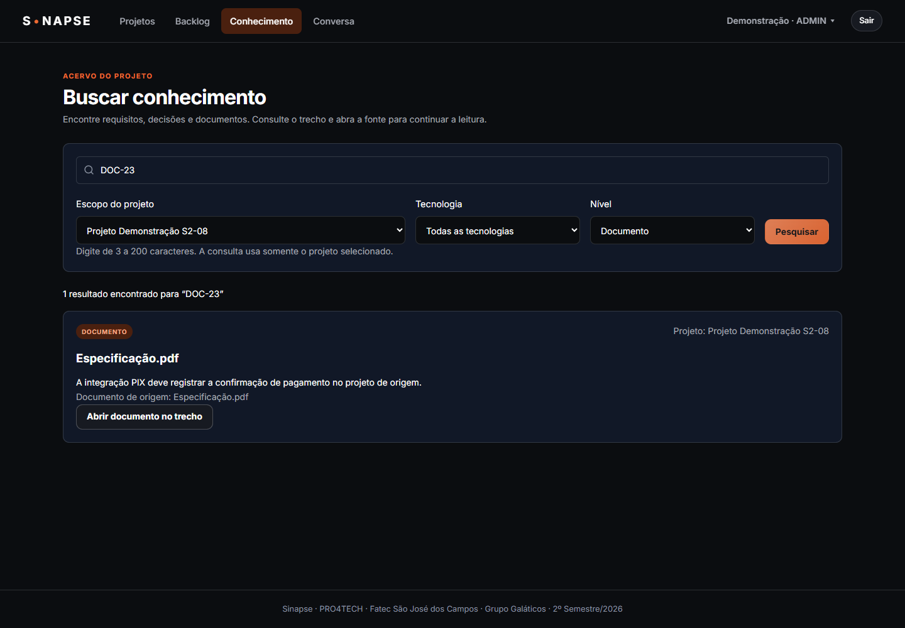
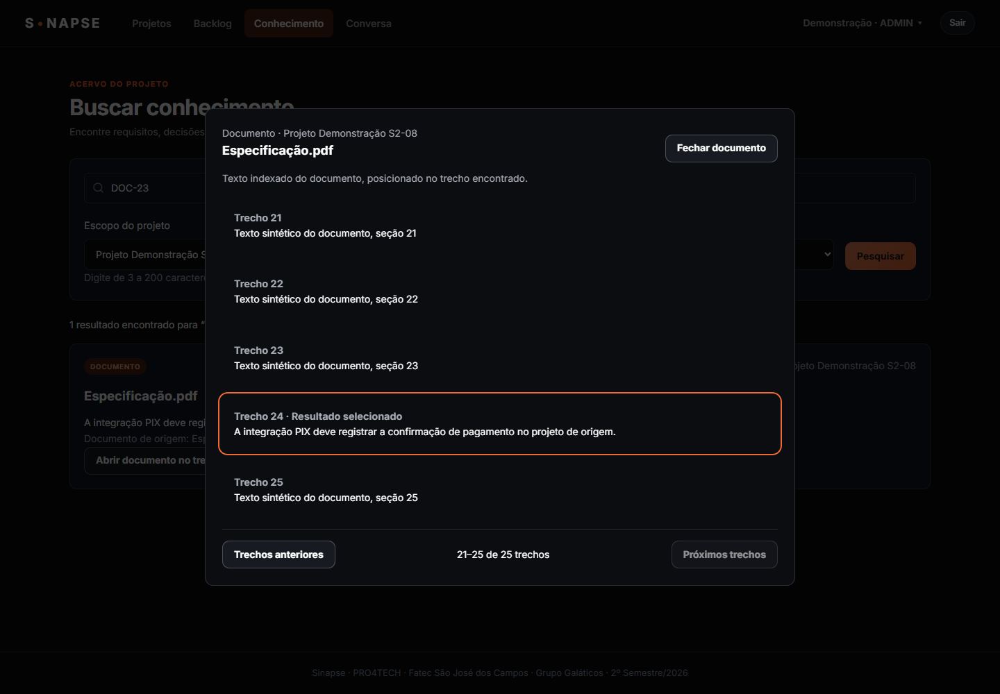
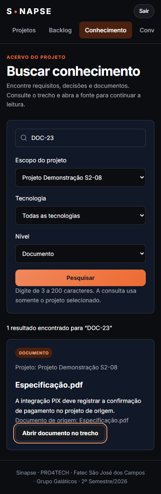

# S2-08 — Busca no acervo

A tela Conhecimento consulta o acervo do projeto selecionado e apresenta título, trecho, projeto e tipo de origem. Os filtros de tecnologia e nível são combinados na API de busca da S2-06.

## Comportamento

- A pesquisa aceita de 3 a 200 caracteres. Os estados inicial, carregando, sem resultados e falha têm mensagens próprias.
- Trocar filtros cancela a consulta anterior e limpa resultados antigos. Uma resposta atrasada não substitui a pesquisa atual.
- Abrir origem navega para o requisito e destaca o texto correspondente. Decisões abrem na aba de decisões, com o cartão identificado.
- Abrir documento no trecho mostra o texto indexado, com destaque e foco no trecho encontrado. A leitura é paginada em grupos de até 20 trechos. Fechar devolve o foco ao botão de origem.
- O leitor apresenta o texto extraído pelo pipeline; não é um visualizador do arquivo PDF/DOCX original. Se o requisito mudou desde a indexação, o endereço ainda abre sua origem, mas o destaque depende de o texto continuar presente.
- A busca usa o limite de resultados da API existente. Não foi adicionada paginação à busca.

## Contrato e isolamento

`GET /api/v1/projects/{projectId}/documents/{documentId}/excerpts?chunk_id={chunkId}&offset={offset}`

A primeira página contém o trecho selecionado; `offset` permite navegar pelas outras páginas. A resposta contém documento, itens de texto, total, offset e next_offset. O contrato está em `docs/api/openapi.yaml`.

A rota exige autenticação e acesso ao projeto. Documento, trecho e projeto devem corresponder; documentos ainda não processados e projetos arquivados não são expostos. Embeddings não são retornados. A leitura usa uma transação com snapshot para manter a paginação consistente durante a requisição.

O frontend rejeita resultados de outro projeto e links externos ou incompatíveis com a origem. Não adiciona logs nem persistência de consultas ou conteúdo. O trecho usado para posicionar um requisito fica no fragmento do endereço, que não é enviado ao servidor.

## Validação

| Camada | Resultado |
| --- | --- |
| Interface | 249 testes passaram, incluindo filtros, respostas atrasadas, isolamento, ausência de resultados e leitor paginado |
| Backend | 335 testes passaram; 25 condicionais foram ignorados na suíte padrão |
| PostgreSQL isolado | Teste dedicado passou: autenticação, projeto, documento, trecho, paginação, parâmetros inválidos, estados não processados, exclusão e arquivamento |
| Navegador + API + PostgreSQL | Busca, abertura no trecho 24, paginação, retorno de foco, navegação ao PBI, ausência de resultados, recuperação de erro 503, tecla Esc e viewport de 390 px passaram |
| Compilação | Build da interface e verificação de tipos do backend passaram |

O teste de navegador utiliza dados sintéticos e resposta de embeddings simulada. Valida a integração da interface com a API e o PostgreSQL, sem medir a qualidade semântica do modelo. O banco temporário é removido ao terminar; os serviços de desenvolvimento são preservados.

Para repetir, em `backend/`, execute `npm run test:integration:knowledge` com Docker aberto. Para o navegador, instale as dependências de `frontend/` e `e2e/`, gere o build do frontend e execute `npm run test:integration:knowledge -- --browser`. O padrão usa Microsoft Edge instalado; `E2E_CHROME_PATH` permite informar outro executável Chromium.

## Evidências

Revisão do PR por outra pessoa é uma etapa externa à implementação e aos testes registrados aqui.

## Revisão adicional

A revisão encontrou carregamento de projetos sem limite de espera quando a rede trava. Foi aplicado o limite de 15 segundos, com mensagem e nova tentativa. A validação do leitor também passou a rejeitar páginas vazias, índices incoerentes e próxima página incompatível com o total. Os novos testes cobrem essas respostas, carregamento de várias páginas de projetos, projetos arquivados, foco após carregamento assíncrono e fragmentos inválidos.
